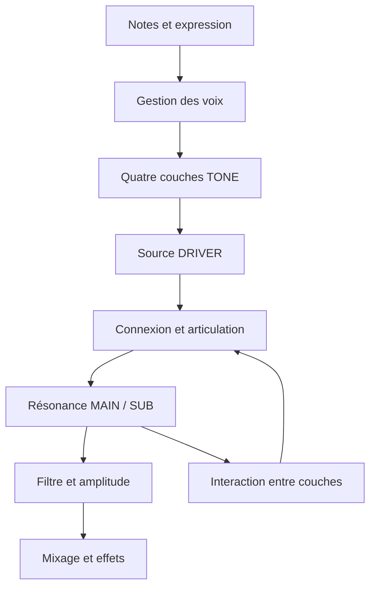

# ANKS — Technics WSA1 : étude et préparation d’un instrument VST

Version 0.1 — 2 novembre 2026 — Auteur : ANKS

## 1. Conclusion de recherche

La documentation donne une base solide pour reconstruire **la logique de programmation** du WSA1. Elle ne donne pas encore une spécification complète permettant de reproduire sa réponse sonore. Notre instrument doit donc préserver la séparation source / connexion / résonance, tout en gardant ses algorithmes remplaçables jusqu’aux comparaisons acoustiques.

Le livrable comprend une étude, un registre des sources, une architecture proposée et un premier banc C++ fonctionnel. Ce banc ne constitue ni une émulation ni un VST3 Windows compilé. La recherche reste ouverte : « toute la documentation possible » est un objectif, pas une exhaustivité acquise.

### Niveaux de preuve

- **A — constructeur** : manuel ou schéma original consulté, même hébergé par une archive.
- **B — brevet primaire** : mécanisme documenté, rattachement au WSA1 non démontré.
- **C — observation indépendante** : analyse de matériel ou de firmware; à reproduire.
- **D — proposition ANKS** : choix d’implémentation, sans attribution à Technics.
- **M — manquant** : élément repéré mais non récupéré ou non vérifié.

## 2. Ce que documente le constructeur

### Organisation musicale — A, manuel Practical Applications [S2]

Un SOUND comporte jusqu’à quatre TONE, avec source DRIVER et résonateur. Les familles comprennent STRING, CYLINDER, CONE, FLARE, PLATE et MEMBRANE; certaines séparent LOW/HIGH. L’interaction peut grouper les couches 1–2, 3–4 ou les quatre.

CONNECTION expose POSITION, DEPTH, FORMANT MOVE/FIX et INTERACTION GAIN. MOVE suit la hauteur; FIX conserve le formant. POSITION MOVEMENT propose largeur, vitesse, S/H et réponse au toucher. Le S/H renouvelle la position à l’attaque et désactive la vitesse.

MAIN/SUB donnent deux résonances réglables : FITTING, MUTING, KEY SHIFT, DETUNE, RESONATOR SCALE. FITTING nul laisse la source seule; l’augmentation de résonance s’accompagne d’une correction du niveau de source. MUTING agit sur l’étouffement des aigus. Le sous-résonateur ajoute notamment son gain.

L’édition couvre aussi hauteur, filtre/EQ, amplitude, enveloppes, LFO et contrôleurs.

Repères : modélisation pp.18–21; couches pp.22–23; hauteur pp.24–26; filtre pp.27–29; amplitude pp.30–32; contrôleurs pp.36–37. Vérifier les plages dans les scans avant codage.

### Matériel et capacités — A, Service Manual [S3]

Le SX-WSA1 est un clavier de 61 touches avec vélocité et aftertouch. Les spécifications annoncent 64 notes et 32 parties maximum. Elles listent 256 sons ROM, 16 kits ROM, 256 sons utilisateur, quatre kits utilisateur et 128 combinaisons dans chaque catégorie ROM/utilisateur.

L’écran est de 320 × 240 points. Deux ensembles MIDI IN/OUT/THRU sont présents. Le séquenceur du clavier comporte 16 pistes, résolution 96 PPQN, capacité approximative 47 000 notes. Ces fonctions de workstation sont secondaires pour notre moteur VST.

Le schéma-bloc distingue un Modeling LSI, un Tone Generator LSI, des mémoires Wave ROM, des DSP et les convertisseurs. **Ce schéma matériel n’est pas un diagramme complet des équations DSP.** Il ne permet pas, seul, de décider comment toutes les opérations acoustiques sont réparties entre puces.

Repères : couverture/spécifications, schéma-bloc pp.17–18 dans le lecteur, schémas des cartes dans la suite. Ne pas déduire « 64 accords de quatre couches » de « 64 notes » : le coût des couches demande une vérification spécifique.

### Paramètres et MIDI — A, Reference Guide [S4]

Le guide de 56 pages contient les effets, l’implémentation MIDI et les structures de données. Repères du lecteur : MIDI p.34, flux p.37, structures pp.48–51, destinations de contrôle p.52.

La page 51 a été examinée visuellement, et pas seulement via OCR. Elle distingue données TONE et MODELING, sélection DRIVER, regroupement INTERACTION, POSITION, paramètres MAIN/SUB, modes de feedback et réponses au toucher.

Quelques domaines de données lisibles : FITTING 0–127; MUTING −50 à +50; KEY SHIFT −50 à +50; DETUNE −128 à +127. MAIN/SUB proposent un choix de feedback positif/négatif. Ces bornes sont des valeurs de commande, pas des unités acoustiques ni des coefficients directement applicables.

Le tableau MIDI associe notamment les CC16/17 et CC18/19 aux contrôleurs XY par défaut. Les assignations sont configurables. La transcription des adresses SysEx, des champs multi-octets et du checksum reste à réaliser sur scans lisibles. **Aucun import de patch WSA1 n’est implémenté dans ce prototype.**

## 3. Documents techniques connexes

### Brevet Matsushita JP2534636B2 — B [S6]

Priorité 1991; publication initiale JPH0519768A en 1993. Le texte décrit des sources mémorisées injectées dans des boucles de retard accordées, avec filtrage et gain de retour. Il aborde les retards fractionnaires, l’amortissement et les interactions entre canaux via un filtre représentant le corps résonant. Des coefficients de corps peuvent provenir d’une réponse impulsionnelle.

C’est une piste historique et mathématique pertinente. **Aucune mention consultée n’établit son utilisation dans le WSA1.** Les descriptions d’état antérieur et les revendications de l’invention doivent rester distinguées.

### Deux autres brevets — B [S7, S8]

JPH05188950A sépare son direct, résonance de marteau, résonance de cordes et bruit d’étouffoir. Il vise surtout des interactions de type piano.

JPH06214563A décrit des réseaux de retards, du traitement spatial et des contrôles de résonance liés au jeu. Il documente des recherches Matsushita contemporaines, pas une architecture WSA1 prouvée.

Les brevets tardifs sur des « acoustic models » dont la priorité est postérieure à 1995 n’ont pas été retenus comme preuves de la conception originale.

### Analyse indépendante de la puce L7A1429 — C [S9]

Un projet de préservation publie une analyse du firmware et du composant de modélisation : registres, accord MAIN/SUB, amortissement et interaction. L’auteur distingue explicitement les écritures observées des hypothèses sur le traitement interne.

L’accès direct a échoué pendant cette session; un contenu indexé substantiel a été consulté. Le dépôt, ses versions et ses mesures n’ont pas été audités. Ses conclusions ne sont donc pas incorporées comme spécification certaine. La prochaine étape utile est de vérifier les références de puces sur les schémas et la provenance des calculs avant tout emprunt d’algorithme.

### Analyses à l’oreille et au spectre — C [S10]

Thor Zollinger décrit ses essais sur un WSA1R, notamment avec une source de bruit. Il propose une lecture en peignes et filtres de coloration, et signale lui-même que son explication interne peut être imparfaite. Ses résultats fournissent des expériences à reproduire; ils ne prouvent pas la topologie des filtres.

Le nombre de 307 drivers et les explications sur leur préparation apparaissent dans ces sources indépendantes. Le catalogue constructeur complet reste à récupérer pour les consolider. Ne pas confondre une liste de résonateurs nommés avec autant d’algorithmes indépendants.

## 4. Image schématique à retenir

### Schéma fonctionnel proposé, déduit des commandes — pas schéma de silicium

L’ordre exact des traitements internes et le point de réinjection de l’interaction restent à identifier. La flèche de retour exprime une fonction utilisateur documentée; elle n’affirme pas un câblage DSP original.

Pour le VST, les étages doivent rester dissociés : remplacer un moteur de résonance ne doit pas imposer de réécrire le lecteur de samples, la modulation ou l’interface.

## 5. Ce qui manque pour se rapprocher du comportement original

| Question | État | Travail nécessaire |
|---|---|---|
| Inventaire complet des sources et résonateurs | Partiel | Récupérer Reference Guide 1 et vérifier les index |
| Technical Guide constructeur | Signalé, non récupéré | Retrouver un exemplaire accessible et en vérifier la nature |
| Préparation exacte des excitations | Non établie | Étudier des sources isolées; ne pas supposer un simple bruit d’attaque |
| Algorithmes de chaque famille | Non publiés dans les manuels consultés | Mesures impulsionnelles, spectres, réponses au jeu |
| Sens acoustique des valeurs FITTING/MUTING | Partiel | Mesurer des balayages de paramètres |
| Compensation d’accord | Inconnue | Mesurer hauteur en fonction de l’amortissement et de la connexion |
| Interaction | Fonction établie, calcul inconnu | Comparer couches isolées et groupées |
| Allocation réelle des 64 notes | À vérifier | Tester plusieurs nombres de couches et modes |
| Débit interne, quantification, interpolation | Non établis | Croiser schémas et analyses de firmware vérifiées |
| FX et routages complets | Inventoriés partiellement | Transcrire le guide; comparer à sec d’abord |
| Compatibilité SysEx | Structures repérées | Transcription visuelle, messages de test, contrôle des tailles |
| Fidélité sonore | Non évaluée | Obtenir un corpus de référence contrôlé |

Les téléchargements de plusieurs archives ont échoué (503, accès refusé ou redirection vers une page d’accueil). Aucun fichier HTML n’est présenté comme PDF récupéré. Les liens restent consignés dans SOURCES.md. Aucun manuel complet ni ROM n’est redistribué dans le ZIP.

## 6. Architecture de notre VST — proposition D

Nom de travail : **Modular**. Ce nom peut changer. Cible initiale : Windows x64, VST3, Ableton Live 12.

### A. Sources

Le moteur final doit lire des excitations enregistrées, avec note racine, vélocité, attaque, boucle éventuelle et enveloppe. Une source peut durer au-delà du transitoire. Des sources synthétiques servent au diagnostic et à la création, sans remplacer tout le modèle original.

Une banque ANKS pourra contenir des frappes, frottements, bruits de souffle, vibrations et formes périodiques enregistrés ou synthétisés pour le projet. Chaque fichier devra conserver son origine. Le banc livré n’embarque qu’une rafale synthétique reproductible.

### B. Connexion

Créer une couche autonome qui transforme le point d’excitation et l’équilibre spectral. Distinguer position de frappe, position de lecture et coloration : trois paramètres pouvant produire des effets voisins sans être équivalents. Le prototype actuel utilise une différence entre prises de retard comme exploration de coloration; ce n’est pas une reproduction de POSITION.

Le futur mode FIX/MOVE doit dissocier hauteur jouée et emplacement des formants. Des macros pourront masquer la complexité, mais les paramètres détaillés resteront accessibles.

### C. Résonateurs interchangeables

Trois candidats sont à comparer avant de figer le moteur :

1. Boucles de retard filtrées, efficaces pour des structures quasi harmoniques.
2. Banques de modes amortis pour des spectres inharmoniques contrôlables.
3. Hybride boucle + filtre de corps, éventuellement identifié à partir de mesures.

Les étiquettes corde, cylindre, cône, pavillon, plaque et membrane décrivent une intention. Il ne faut pas affecter automatiquement un algorithme physique moderne à chacune en prétendant reproduire le WSA1. Par exemple, une banque modale de plaque serait une extension ANKS tant que la comparaison ne l’a pas justifiée.

### D. Interaction

Prévoir une matrice de couplage explicite et des groupes reproduisant les associations du panneau. Commencer avec des échanges retardés d’au moins un échantillon, un gain normalisé et des pertes contrôlées. Ne pas simplement sommer plusieurs feedbacks proches de l’unité : la stabilité de chaque boucle seule ne garantit pas celle du réseau.

Les résonances entre notes distinctes et les interactions entre couches d’une même note doivent être séparées dans le modèle de données. Le comportement original exact reste à déterminer.

### E. Jeu et interface

Quatre cartes de couches, une vue de connexion et deux surfaces XY. Grandes courbes et valeurs lisibles, zoom d’interface, zones tactiles confortables. Prévoir une vérification sur l’écran Windows à 300 % avant de valider la présentation.

En première page : SOURCE, CORPS, CONNEXION, MOUVEMENT. La page avancée expose accord, amortissement, MAIN/SUB et routage. Les macros devront avoir une plage utile et pouvoir être automatisées dans Ableton. Un geste peut piloter plusieurs paramètres, mais sa correspondance doit être consultable.

Les modernités proposées — import WAV, courbes synchronisées, modulation aléatoire reproductible, MPE et modèles hybrides — restent identifiées comme ajouts. L’accès au comportement de base doit toujours rester simple.

## 7. Banc DSP livré : ce qu’il prouve et ne prouve pas

Le cœur C++ est indépendant de JUCE. Une boucle reçoit une excitation, un retard fractionnaire linéaire, un filtre passe-bas à un pôle et un gain de retour. Une inversion du feedback et une demi-période explorent un spectre privilégiant les harmoniques impaires. Deux instances forment MAIN/SUB.

Pour un délai de D échantillons et un T60 visé, le gain scalaire initial est :

`g = 10 ^ (-3 D / (Fs T60))`

Cette formule suppose une perte scalaire par tour; filtrage et interpolation ajoutent des pertes et de la phase. Elle ne garantit donc ni un T60 identique pour tous les partiels, ni un accord exact. Une compensation fréquentielle reste nécessaire. Le modèle courant ne simule pas une géométrie complète.

Le choix du retard utilise approximativement `D = Fs / f`. La variante inversée emploie `D = Fs / (2 f)`. Les retards sont bornés et les états préalloués. Les paramètres du banc sont statiques pendant une note; un futur lissage ne doit pas déplacer brutalement un retard dans une boucle fortement résonante.

Le cadre théorique des guides d’ondes, pertes et contraintes de passivité est documenté par Julius O. Smith [S11]. Il sert à notre conception; il ne démontre pas une identité avec Technics.

### Vérifications effectuées

Compilation GCC 13.3, C++17, avertissements activés. Quatre fréquences d’échantillonnage, cinq fréquences de note et deux polarités : 40 réponses impulsionnelles. Vérification de sortie finie, bornes et décroissance. Test spectral du rejet de la deuxième harmonique dans la variante inversée. Remise à zéro sans résidu. Somme de 16 voix pendant une seconde sans valeur non finie.

Ces essais ne constituent pas une mesure de CPU sur ton i5, une comparaison au WSA1 ou un test du plugin dans Ableton. Une base JUCE/VST3 est écrite, mais non compilée : CMake et JUCE ne sont pas installés ici. L’éditeur est générique, sans design final. Les dépendances ne sont pas incluses.

## 8. Protocole de comparaison à préparer

Pour chaque capture de référence : noter modèle, version, patch initial, paramètres, note MIDI, vélocité, fréquence d’échantillonnage, durée et éventuelle normalisation. Désactiver effets et couches inutiles. Garder les niveaux fixes et conserver les fichiers bruts.

Captures prioritaires :

- Une couche, source seule, plusieurs registres et vélocités.
- Même source avec chaque famille, même hauteur et même niveau.
- Balayages séparés de FITTING, MUTING, POSITION et accord.
- MAIN seul puis SUB seul, puis leur mélange.
- Couches séparées puis couplées, unisson puis intervalles.
- Notes longues pour identifier boucles, évolution spectrale et fins de son.

Mesures : réponse transitoire, spectrogramme, hauteur, pics résonants, décroissance par bande, variation de niveau et différence entre notes répétées. Comparer d’abord des grandeurs observables; la préférence musicale vient ensuite. Les vidéos de démonstration compressées restent utiles à l’écoute générale mais insuffisantes pour calibrer précisément un moteur.

## 9. Jalons concrets

**J0 — livré :** recherche initiale, classification des preuves, schéma fonctionnel, banc C++ et adaptateur de plugin préparatoire.

**J1 :** compléter les catalogues, décrire les excitations et établir un corpus de référence. Le travail peut continuer avec des sources originales en attendant le matériel.

**J2 :** instrument jouable à une couche avec lecture de sample et MAIN/SUB, accord calibré, sauvegarde et expression MIDI élémentaire. Compilation et chargement VST3 sur Windows.

**J3 :** quatre couches, interactions stables, contrôles de connexion et comparaison des familles. Mesurer la consommation réelle avant de promettre une polyphonie.

**J4 :** interface moderne, courbes, presets ANKS, puis extensions. Laisser une voie de comparaison sobre sans effets pour suivre les progrès.

La prochaine décision technique doit porter sur la qualité du couple excitation/résonateur, pas sur la décoration. Le moteur simple est un outil pour choisir; il ne fige pas encore le synthétiseur final.
